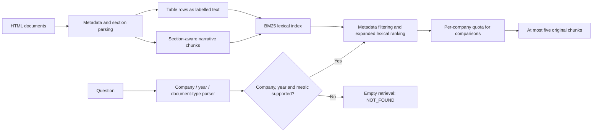

# FTEC5660 Homework 4

## Homework 4 solution

### Pipeline

The parser preserves every table value with its row label, column header and caption. The chunker extracts company, fiscal year and document type from each document, keeps section context, and emits narrative passages plus individual table rows of at most 1,500 characters. Retrieval combines BM25 with concept synonyms, exact-year preferences and company/document-type filters; comparisons receive separate retrieval quotas so one similarly named company cannot dominate. Abstention rejects unknown companies, uncovered annual-report years and questions whose distinctive metric terms are absent from the relevant documents. These choices target table ambiguity, company/year confusion, one-sided comparisons and unsupported answers without using embeddings or external data.

### Ablation study

All configurations are implemented in `ablation.py` and evaluated on the same 60 public questions. **Valid** is valid non-empty retrieval on answerable questions; **Kept** and **Rejected** measure non-empty retrieval on answerable questions and empty retrieval on unanswerable questions, respectively.

| Variant | Incremental change | Chunks | Valid | Recall@5 | Kept | Rejected | Answer accuracy |
|---|---|---:|---:|---:|---:|---:|---:|
| B0 | Naive `get_text`, recursive chunks, full-corpus BM25 | 249 | 100.0% | 26.1% | 100.0% | 0.0% | 48.3% |
| V1 | + structured table text | 291 | 100.0% | 26.1% | 100.0% | 0.0% | 41.7% |
| V2 | + section/table-row chunks and headers | 2,555 | 100.0% | 26.1% | 100.0% | 0.0% | 41.7% |
| V3 | + query parsing and company/type/year filtering | 2,555 | 100.0% | 93.5% | 100.0% | 0.0% | 95.0% |
| V4 | + punctuation/number-aware tokenizer | 2,555 | 100.0% | 97.8% | 100.0% | 0.0% | 96.7% |
| V5 | + concept synonym expansion | 2,555 | 100.0% | 100.0% | 100.0% | 0.0% | 100.0% |
| V6 | + field/year-aware ranking weights | 2,555 | 100.0% | 100.0% | 100.0% | 0.0% | 100.0% |
| V7 | + per-company comparison quotas | 2,555 | 100.0% | 100.0% | 100.0% | 0.0% | 100.0% |
| V8 | + explicit abstention | 2,555 | 100.0% | 100.0% | 100.0% | 100.0% | 100.0% |

V1 and V2 did not improve recall: table structure and smaller chunks alone could not overcome full-corpus company/year ambiguity. V3 was the largest improvement, followed by the tokenizer and synonym expansion. V6 and V7 had no additional public-set effect because recall was already saturated; they remain safeguards against ambiguous fields/years and one-sided comparisons. V8 raised rejection from 0% to 100% without losing recall. The generator had already answered every unsupported question correctly in V5–V7 despite receiving chunks, so answer accuracy was saturated; the rejection metric isolates V8's contribution.

### Error analysis

The naive baseline loses row–column relationships in tables and lets shared company words and adjacent years dominate lexical similarity. Structured rows and metadata-aware ranking address these errors, while per-company quotas guard against comparisons with evidence for only one side. The final abstention rule handles unknown entities, unavailable years and undisclosed metrics instead of supplying loosely related passages. The final public run has no remaining retrieval or answer errors; the main residual risk on unseen data is wording that evades the deterministic company or metric parser.

## Task 6: Reflection

**Student ID: 1155264981**

1. **What kind of person would you want to be in that world?** I want to become someone who is highly proficient with AI tools and understands business, turning technology into reliable practical value.
2. **Which of your current ambitions would still matter?** I will still aspire to understand financial business deeply, keep learning, and solve real-world problems.
3. **What would you want to be known for beyond your productivity and professional achievements?** I want to be known for integrity, reliability, helpfulness, and trustworthiness, not merely for my output.
4. **What are you willing to struggle for, even when an AI agent could make the struggle unnecessary?** I am willing to struggle for independent thinking, professional judgment, and personally solving complex problems, even when AI makes the work easier.
5. **What skills, qualities, or experiences would still make you valuable?** Business understanding, critical thinking, communication and collaboration, honesty and responsibility, and experience applying AI to real scenarios will keep me valuable.
6. **If your value is no longer determined primarily by what you can do, how will you define who you are?** I will define myself by my values, responsibility, curiosity, and positive impact on others rather than by how quickly I produce output.
7. **What should you start doing differently tomorrow?** Starting tomorrow, I will use AI more proactively in learning and business practice while preserving verification, reflection, and independent decision-making.
